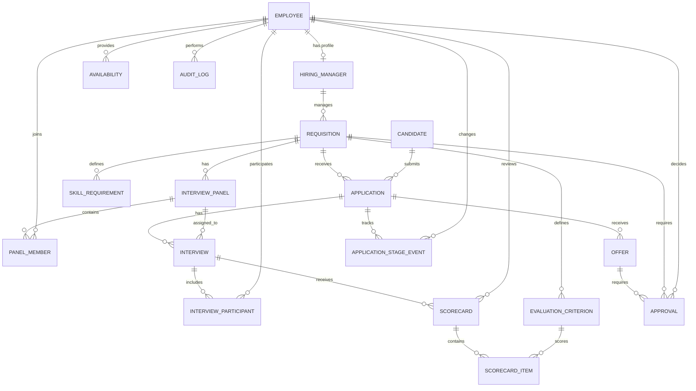

# HireFlow — Entity Relationship Diagram

## 1. Database Relationships

## 2. Relationship Explanation

| Relationship | Cardinality | Meaning |
|---|---|---|
| Employee → HiringManager | 1 : 0..1 | An employee may have a hiring manager profile |
| HiringManager → Requisition | 1 : Many | One manager can manage multiple requisitions |
| Requisition → Application | 1 : Many | One job opening can receive multiple applications |
| Candidate → Application | 1 : Many | One candidate can submit multiple applications |
| Requisition → SkillRequirement | 1 : Many | A requisition can require multiple skills |
| Requisition → InterviewPanel | 1 : Many | A requisition can have multiple panels |
| InterviewPanel → PanelMember | 1 : Many | A panel contains multiple employees |
| Employee → Availability | 1 : Many | An employee can have multiple availability slots |
| Application → Interview | 1 : Many | An application can have multiple interviews |
| Interview → InterviewParticipant | 1 : Many | An interview can include multiple interviewers |
| Interview → Scorecard | 1 : Many | An interview can receive multiple reviews |
| Requisition → EvaluationCriterion | 1 : Many | Evaluation criteria are defined for each role |
| Scorecard → ScorecardItem | 1 : Many | A structured scorecard records criterion scores |
| EvaluationCriterion → ScorecardItem | 1 : Many | A criterion may be scored across many scorecards |
| Application → Offer | 1 : Many | An application can have multiple historical offers |
| Offer → Approval | 1 : Many | An offer can require multiple approvals |
| Application → ApplicationStageEvent | 1 : Many | An application has a history of stage changes |
| Approval → Offer / Requisition | 1 : 0..1 target | Exactly one optional target is populated, matching approval type |

## 3. Important Database Design Decisions

1. **Candidate and Requisition:** Connected through Application, forming a many-to-many relationship.
2. **Interview scheduling:** InterviewParticipant identifies the actual interviewers. Availability is checked against each participant's scheduled interviews.
3. **Evaluation:** Each interviewer submits a separate scorecard.
4. **Offer approval:** Multiple approvers can review an offer independently.
5. **Audit history:** ApplicationStageEvent and AuditLog preserve historical changes rather than overwriting them.
6. **Historical offers:** Multiple offers can exist for one application, but business rules must prevent multiple simultaneously active offers.
7. **Evaluation rubric:** ScorecardItem bridges Scorecard and EvaluationCriterion; criteria are unique within each scorecard.
8. **Effective dates:** Availability and Interview use UTC start/end intervals. Other lifecycle history uses timestamped events; master data is not effective-dated.
9. **Operations role:** EmployeeRole includes HR, hiring manager, interviewer, approver, administrator, and operations partner.

## 4. Constraints to Enforce

- All primary keys must be unique.
- All foreign keys must reference existing records.
- Candidate email and employee email must be unique.
- Candidate-requisition combinations must be unique.
- Panel membership must not contain duplicate employees.
- Interview participation must not contain duplicate employees.
- An employee cannot have overlapping scheduled interviews.
- Interview end time must be after start time.
- Offer salary must be checked against the requisition salary band.
- Approval must reference exactly one target: an offer or a requisition.
- Stage transitions must follow documented workflow rules.
- Historical events must not be silently modified or deleted.
- Availability and interview intervals must end after their start.
- Compensation, rubric scores, skill weights, and requisition openings must satisfy documented numeric bounds.
